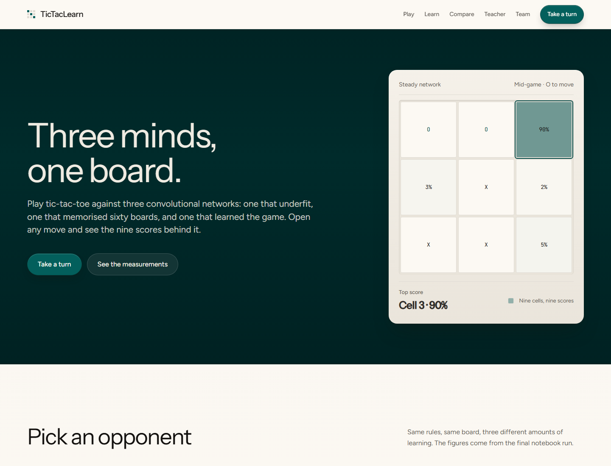
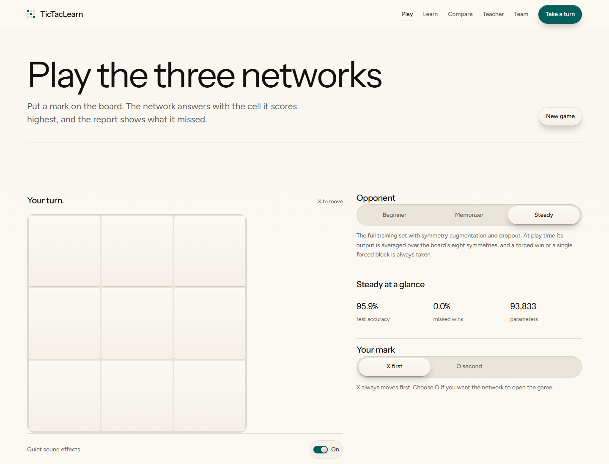
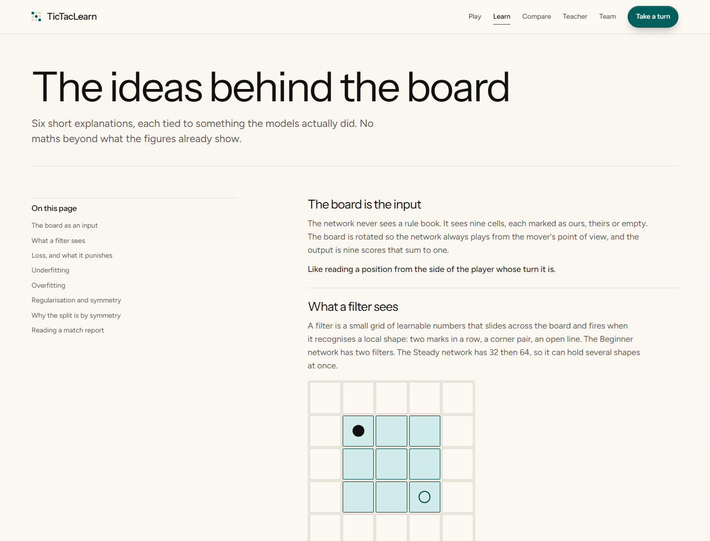
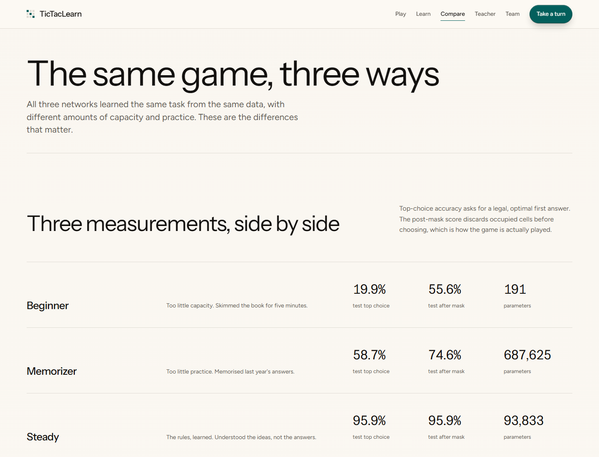
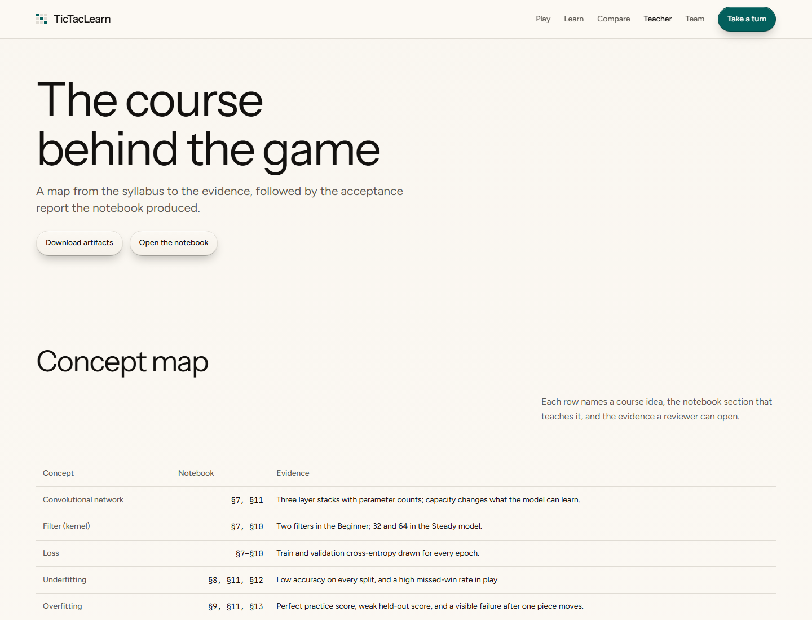

<div align="center">

# TicTacLearn

Play tic-tac-toe against three neural networks — and see exactly why each one plays the way it does.

[](https://tictaclearn-three.vercel.app)
&nbsp;
[](https://github.com/Srabon-bot/cnn-tictactoe-playground/blob/main/tictactoe_cnn.ipynb)
&nbsp;
[](https://github.com/Srabon-bot/cnn-tictactoe-playground)

</div>

---

## Overview

TicTacLearn is a teaching project that turns a familiar game into a hands-on lesson about machine learning. Three CNN opponents are trained on the same task but deliberately learn in different ways: one barely learns, one memorizes, and one generalizes. After every game the site explains, in plain language, what the AI did and why.

This is a **Part A notebook + Part B website** project from the University of Information Technology and Sciences (UITS), Department of Computer Science and Engineering.

**Live site:** [https://tictaclearn-three.vercel.app](https://tictaclearn-three.vercel.app)

> **Academic title:** *Learn by Playing: A CNN-Based Tic-Tac-Toe Game for Teaching Overfitting and Underfitting*

---

## Screenshots

<div align="center">

### Home & Hero Instrument



### Play the Three Networks



### Learn & Compare

<br />

| Learn the Ideas | Compare the Three |
|:---:|:---:|
|  |  |

### Teacher View



</div>

---

## Features

- Play against three opponents with visibly different learning behavior
- Choose **X first** or **O second**; X always opens the game
- See all nine network scores for every move as a probability heat map
- Legal-move masking that separates the raw top choice from the move actually played
- A post-game report that names missed wins, missed blocks, illegal choices, and the final result
- A move-by-move timeline with every board and network answer kept
- The same board read by all three models side by side
- A Learn page covering filters, loss, underfitting, overfitting, regularization, and symmetry
- A Compare page with accuracy tables, game records, charts, and training curves
- A Teacher page with a syllabus concept map, acceptance report, notebook link, and artifact download
- Fully static site with no backend, no accounts, and no stored scores
- Hand-written JavaScript forward pass over exported weights
- Parity tests against twenty Python boards per model
- Downloadable `.keras` models, portable weights, JSON data, plots, and the full archive
- Responsive layout, keyboard-accessible controls, and clear post-game feedback

---

## Tech Stack

| Layer | Technology |
|---|---|
| Notebook |   Google Colab |
| Modeling |    |
| Evaluation |  memoized minimax, gameplay simulation |
| Verification |  nbclient, nbconvert, acceptance checks |
| Framework |  App Router |
| UI library |  |
| Language |  |
| Styling |  |
| Charts |  |
| Icons & effects |   |
| Hosting |  |

---

## Routes

| Route | Page |
|---|---|
| `/` | Hero, opponent picker, how a game becomes a lesson, and links to every section |
| `/play` | Play against Beginner, Memorizer, or Steady; heat maps, timeline, and post-game report |
| `/learn` | Six plain-language explanations of the ideas behind the board |
| `/compare` | Accuracy tables, game records, training curves, and the same board read three ways |
| `/teacher` | Concept map, acceptance report, notebook link, and artifact downloads |
| `/about` | The team, the notebook-to-browser pipeline, and what the site does not claim |

The site is fully static. There is no login, database, server runtime, or saved score.

---

## The Three Opponents

| Level | Internal model | What it demonstrates |
|---|---|---|
| **Beginner** | `underfit` | A model that learned too little: close to random, misses wins and blocks |
| **Memorizer** | `overfit` | A model that memorized its practice boards: perfect on those, poor on new ones |
| **Steady** | `stable` | A model that learned the patterns: averages over the board's symmetries and never loses an evaluated game |

The three models share the same input and output shape, but differ in capacity, training set, and regularization. That is the whole experiment: same task, same labels, deliberately different learning outcomes.

---

## How It Works

```text
Reachable boards
      │  memoized minimax
      ▼
Optimal-move labels
      │  group by 8 symmetries
      ▼
70 / 15 / 15 group-disjoint split
      │  encode from mover's view
      ▼
Three CNNs
      │  train + evaluate
      ▼
Artifacts
      │  export + copy
      ▼
Static Next.js site  ──►  Browser forward pass
```

1. **Generate the data.** Every non-terminal board reachable from the empty board is enumerated; none of it is imported from an external dataset.
2. **Label with minimax.** A memoized minimax returns the set of optimal moves for each position, stored as a soft target over those moves.
3. **Prevent symmetry leakage.** Boards are grouped by their canonical form across eight rotations and mirrors, then split 70% / 15% / 15% by group. A rotated training board never appears in validation or test.
4. **Encode from the mover.** The 3×3 board is always read from the perspective of the player whose turn it is: own marks `+1`, opponent `-1`, empty `0`.
5. **Train three CNNs.** The Beginner has two filters and a few epochs; the Memorizer is trained on sixty boards until it knows them perfectly; the Steady model uses the full set, augmentation, dropout, and early stopping.
6. **Export and serve.** The notebook writes models, weights, JSON histories, metrics, plots, and a zip. The website runs a hand-written JavaScript forward pass over `weights.json`; no Python server is involved.

### Why the split matters

Tic-tac-toe boards have eight symmetries. A random row split would put rotations of the same board in both training and test, making a memorizing model look better than it is. Grouping by canonical form makes the held-out score an honest test of generalization across genuinely unseen shapes.

---

## Results

All metrics are generated deterministically from seed `42` across **4,520 reachable non-terminal positions**, grouped into **627 canonical forms** and split 70% / 15% / 15% by group.

Accuracy is reported two ways. **Top choice** is the primary score: the cell the network ranks first must be empty and minimax-optimal. **After mask** discards occupied cells before choosing, which is how the game engine actually plays. The post-mask number is generous — "always take the first empty cell" already scores about 59% on these labels — so both are always shown together.

| Model | Parameters | Train top choice | Validation top choice | Test top choice | Test after mask |
|---|---:|---:|---:|---:|---:|
| `underfit` | 191 | 20.5% | 17.4% | 19.9% | 55.6% |
| `overfit` | 687,625 | 100.0% | 53.7% | 58.7% | 74.6% |
| `stable` | 93,833 | 100.0% | 98.4% | **95.9%** | 95.9% |

### Gameplay Evaluation

Each model plays **1,200 games**: 1,000 against random play and 200 against minimax. The Steady model averages its answer over all eight rotations and mirrors, then takes an immediate win or the single forced block when one exists.

| Model | vs random (1,000 games) | vs minimax (200 games) | Missed win | Missed block | Illegal first choice |
|---|---|---|---|---|---|
| `underfit` | 500W / 108D / 392L | 0W / 1D / 199L | 62.5% | 88.1% | 47.8% |
| `overfit` | 707W / 104D / 189L | 0W / 52D / 148L | 33.7% | 67.2% | 20.8% |
| `stable` | **944W / 56D / 0L** | **0W / 200D / 0L** | **0.0%** | **0.0%** | **0.0%** |

### Acceptance and Reproducibility

| Measure | Value |
|---|---|
| Acceptance checks | 12 / 12 passed |
| Notebook runtime | 2.4 minutes |
| Reproducibility | Two back-to-back runs match within `1e-9` |
| Parity checks | 20 boards per model, Python vs JavaScript |
| Exported artifacts | 3 `.keras` models, 3 `weights.json`, JSON metrics, 7 plots, `artifacts.zip` |

The full acceptance table is written to `reports/acceptance_report.md` and `artifacts/data/acceptance.json`. Every number on the site is read from these exports, not typed by hand.

---

## Local Development

**Prerequisites:** Python 3.10 for local notebook verification and Node.js 20.9+ for the website. The notebook is designed to run unchanged on free Google Colab.

### Part A — Run the notebook

**Google Colab (the intended environment)**

1. Upload `tictactoe_cnn.ipynb` to [Google Colab](https://colab.research.google.com/).
2. Choose **Runtime → Run all**.
3. The notebook writes everything to `/content/artifacts/` and offers `artifacts.zip` for download.

A full run is designed to take under 10 minutes on the free CPU runtime.

**Local verification (optional)**

```powershell
powershell -ExecutionPolicy Bypass -File tools/setup_env.ps1
.\.venv\Scripts\python.exe tools\build_notebook.py
.\.venv\Scripts\python.exe tools\execute_notebook.py
.\.venv\Scripts\python.exe tools\verify_acceptance.py --save-run reports\run1_metrics.json
```

Run the notebook a second time and compare to prove reproducibility:

```powershell
.\.venv\Scripts\python.exe tools\verify_acceptance.py --compare reports\run1_metrics.json
```

The executed notebook is committed with its outputs, so you can read the results without running anything.

### Part B — Run the website

```powershell
cd web
npm install
npm run test
npm run lint
npm run dev
```

Open [http://localhost:3000](http://localhost:3000). To check the production build:

```powershell
npm run build
```

### Artifacts and inference

The site is fully static. It reads the JSON and weights the notebook exports from `web/public/artifacts/`. After a new notebook run, copy `artifacts/data`, `artifacts/models`, `artifacts/plots`, and `artifacts/artifacts.zip` into that folder.

Inference is a hand-written JavaScript forward pass over the exported `weights.json` files. The notebook first attempts a TensorFlow.js conversion; when the installed converter cannot read the current Keras format, it writes `weights.json` and records the fallback in `artifacts/data/export_status.json`. This is stated on the About page rather than hidden. Twenty boards per model are checked against Python in `web/src/lib/engine/engine.test.ts`.

---

## Deployment

The live site is deployed on Vercel at [https://tictaclearn-three.vercel.app](https://tictaclearn-three.vercel.app).

**Vercel.** Import the repository, set the project root to `web/`, and use the configuration already in `web/vercel.json`:

- install command: `npm install --legacy-peer-deps`
- build command: `npm run build`
- no environment variables or server functions

The config also sets a one-hour cache with stale-while-revalidate for `/artifacts/*`, so model weights and plots are not re-downloaded on every visit.

The site is a standard Next.js build. Any host that can run Next.js or serve the build output will work; no Python runtime is needed after the artifacts are copied into `web/public/artifacts/`.

---

## Team

| Name | Student ID | Batch / Section | Role |
|---|---|---|---|
| Md. Shahriar Hossain Srabon | 0432310005101056 | 53 / B1 | Dataset, training, artifact export |
| Lubna Jahan Lipa | 0432310005101088 | 53 / B2 | Game logic, interface, level selection |
| Tamanna Khokon | 0432310005101082 | 53 / B2 | Model integration, explanations, evaluation, report |

Department of Computer Science and Engineering, University of Information Technology and Sciences (UITS).

---

## Limits

Limits are part of the lesson, so they are written down:

- **Generated data only.** The project does not use an external dataset; every board is enumerated from the game tree and labeled by minimax.
- **The Steady model does not win against perfect play.** It draws all 200 evaluated games against minimax and never loses, but it does not force a win.
- **Held-out accuracy is below 100%.** The Steady model scores 95.9% top-choice accuracy on the test split.
- **The post-mask score is generous.** The engine discards occupied cells before choosing, so top-choice accuracy remains the primary number.
- **TensorFlow.js conversion is a fallback.** The notebook exports portable `weights.json` and records the conversion status instead of hiding it.
- **No accounts or stored scores.** The site keeps no profile, history, or leaderboard.
- **Browser inference is a small forward pass.** It reproduces the exported CNN for this board and model shape; it is not a general TensorFlow runtime.

---

## Repository Map

```text
TicTacLearn/
├── README.md
├── PRD_TicTacToe_CNN_Notebook.md       # original project requirements
├── requirements-notebook.txt           # pinned Python environment
├── tictactoe_cnn.ipynb                 # Part A notebook, saved with outputs
├── artifacts/
│   ├── data/                           # metrics, histories, gameplay, parity vectors
│   ├── models/                         # .keras models + portable weights.json
│   ├── plots/                          # seven exported figures
│   └── artifacts.zip                   # downloadable archive
├── tools/                              # build, execute, and acceptance scripts
├── reports/                            # run metrics and acceptance report
├── docs/screenshots/                   # README captures
└── web/                                # Part B Next.js site
    ├── src/app/                        # Home, Play, Learn, Compare, Teacher, About
    ├── src/components/                 # board, reports, charts, navigation
    ├── src/lib/engine/                 # rules, inference, analysis, parity tests
    └── public/artifacts/               # notebook exports served to the browser
```

---

## Documentation

| Document | What it covers |
|---|---|
| [`PRD_TicTacToe_CNN_Notebook.md`](PRD_TicTacToe_CNN_Notebook.md) | The original notebook and website requirements |
| [`web/README.md`](web/README.md) | Site-specific setup, artifacts, inference, and deployment notes |
| [`reports/acceptance_report.md`](reports/acceptance_report.md) | The generated acceptance table |
| [`artifacts/data/acceptance.json`](artifacts/data/acceptance.json) | The same acceptance report as machine-readable data |
| [`artifacts/artifacts.zip`](artifacts/artifacts.zip) | The full run: models, weights, JSON, plots, and notebook outputs |

---

## Credits

Built by **Md. Shahriar Hossain Srabon**, **Lubna Jahan Lipa**, and **Tamanna Khokon** for the Department of Computer Science and Engineering at the **University of Information Technology and Sciences (UITS)**.

<div align="center">

<sub>Notebook in Python · Site in Next.js · Three models, one board</sub>

</div>
